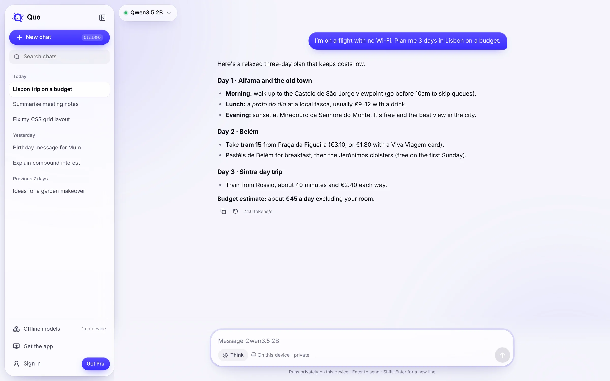

<div align="center">


# Quo

**Private AI that works offline.**

A free, open-source AI assistant that runs on your own device: in your browser, on your desktop, and on your phone.<br>
No account, no internet needed, and nothing you type leaves your device.<br>
**11,000+ installs on Android.**

[**Try Quo in your browser →**](https://quoai-app.vercel.app/)

[Website](https://quoai.vercel.app) · [Download for desktop](https://github.com/quo-ai/quo/releases/latest) · [Google Play](https://play.google.com/store/apps/details?id=com.quo.app) · iPhone coming soon

[](LICENSE)
[](https://github.com/quo-ai/quo/actions/workflows/ci.yml)
[](https://github.com/quo-ai/quo/releases/latest)

<br>



</div>

## Why Quo

Most AI assistants run on someone else's servers. You need an account and a connection, and your conversations are stored there.

Quo runs the model on your device instead:

- **Works offline.** On a plane, abroad, anywhere without signal.
- **Private by design.** Chats, files, photos and voice are processed on your device. No account, no server copy.
- **Open source.** “Private” is something you can check, not just a promise.
- **Free.** Offline models are free and unlimited.

## Get Quo

| | How it runs | Get it |
|---|---|---|
| **Web** | [wllama](https://github.com/ngxson/wllama) (llama.cpp in WebAssembly), on the graphics card in Chrome and Edge | [quoai-app.vercel.app](https://quoai-app.vercel.app/) |
| **Desktop** | llama.cpp on the graphics card, in an app for macOS, Windows and Linux | [macOS](https://github.com/quo-ai/quo/releases/latest/download/Quo-mac-universal.dmg) · [Windows](https://github.com/quo-ai/quo/releases/latest/download/Quo-windows-x64-setup.exe) · [Linux](https://github.com/quo-ai/quo/releases/latest/download/Quo-linux-x86_64.AppImage) |
| **Android** | [llama.rn](https://github.com/mybigday/llama.rn), with a model built in | [Google Play](https://play.google.com/store/apps/details?id=com.quo.app) |
| **iPhone and iPad** | llama.rn on Metal | Coming soon |

In a browser, use Chrome or Edge on a computer: Firefox and Safari run on the processor, which is slower, and phone browsers don't have the memory (use the app).

## Features

| | Web | Desktop | Phone |
|---|:-:|:-:|:-:|
| Offline models, working with no internet | ✓ | ✓ | ✓ |
| Thinking you can read | ✓ | ✓ | ✓ † |
| Ask about documents | ✓ | ✓ | ✓ |
| Understand photos | | ✓ | ✓ |
| Voice input and read aloud | ✓ | ✓ | ✓ † |
| A free cloud model, and your own API keys (OpenRouter, Anthropic, OpenAI, Ollama…) | ✓ | ✓ | |
| Web search with sources, when the model needs it | ✓ | ✓ | |
| Code mode: a coding agent that asks before every change, commit and push | | ✓ | |

† Part of the optional one-time Premium upgrade on the phone.

## Models

Open models, downloaded once and kept on your device. Quo checks your hardware and suggests one that runs well.

| Model | Download | Runs well on | Where | Licence |
|---|---|---|---|---|
| Qwen3.5 0.8B | 0.5 GB | almost any phone or computer | phone, browser | Apache 2.0 |
| Qwen3.5 2B | 1.3 GB | 6 GB phones, 8 GB computers | phone, browser | Apache 2.0 |
| Llama 3.2 3B | 2.0 GB | 8 GB phones and computers | everywhere | Llama 3.2 Community |
| Ministral 3B (vision) | 2.1 GB | 8 GB phones | phone | Apache 2.0 |
| Qwen3.5 4B (vision, thinking) | 2.7 GB | 8 GB phones and computers | phone, desktop | Apache 2.0 |
| Gemma 4 E2B (vision, thinking) | 2.6–3.1 GB | 8 GB phones and computers | everywhere | Gemma terms |
| Phi-4 Mini | 2.5 GB | 8 GB phones and computers | phone, desktop | MIT |
| Qwen3.5 9B (vision, thinking) | 5.9 GB | 16 GB computers, or an 8 GB graphics card | desktop | Apache 2.0 |
| Gemma 4 12B (vision, thinking) | 6.9 GB | 16 GB computers, or an 8 GB graphics card | desktop | Gemma terms |
| Gemma 4 26B A4B (vision, thinking) | 15.4 GB | 24 GB computers | desktop | Gemma terms |
| Qwen3.8 27B (vision, thinking) | 17.4 GB | 32 GB computers | desktop | Apache 2.0 |

Full lists: [`apps/mobile/constants/models.ts`](apps/mobile/constants/models.ts) (phone) and [`apps/web/src/catalog.ts`](apps/web/src/catalog.ts) (web and desktop).

## Pricing

Quo Web and the desktop app are free, including a free cloud model (20 messages a day). The phone app is free with three models; a one-time **Premium** upgrade (from $9.99) unlocks every model, thinking, voice, and unlimited chats and memories.

## Build from source

**Quo Web**

```bash
cd apps/web
npm install
npm run dev        # http://localhost:5173
```

**Desktop app** (see [`apps/desktop/README.md`](apps/desktop/README.md))

```bash
cd apps/web && npm install && npm run build
cd ../desktop && npm install && npm run dev
```

**Phone apps** (Expo SDK 57 / React Native, New Architecture)

```bash
cd apps/mobile
npm install
npm run android    # or: npm run ios (macOS)
```

Each app has its own checks (`npm run typecheck`, `npm test`, and `npm run lint` for the phone app). [`CLAUDE.md`](CLAUDE.md) covers the architecture and the rules that keep it safe; [`apps/web/README.md`](apps/web/README.md) and [`apps/desktop/README.md`](apps/desktop/README.md) go deeper.

## Repository

```
apps/mobile/    Phone app: Expo / React Native, llama.rn
apps/web/       Quo Web (Vite + React, wllama) and its API (server/)
apps/desktop/   Desktop app: Electron and llama.cpp, serving a Quo Web build
website/        quoai.vercel.app (static)
```

## Contributing

Issues and pull requests are welcome: see [CONTRIBUTING.md](.github/CONTRIBUTING.md) and the [Code of Conduct](.github/CODE_OF_CONDUCT.md). Report security issues privately ([SECURITY.md](.github/SECURITY.md)).

## License

[Apache 2.0](LICENSE). The licence doesn't cover the Quo name, logo or icons, so forks need their own ([TRADEMARKS.md](TRADEMARKS.md)). Brand assets: [quoai.vercel.app/brand](https://quoai.vercel.app/brand/).
